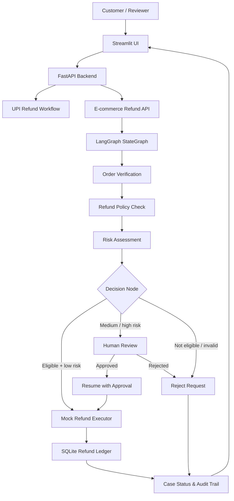
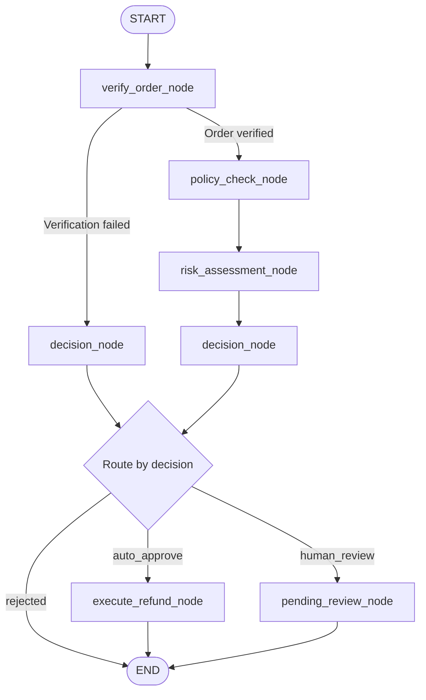

<div align="center">

# 💳 Refund Recovery & Autonomous E-commerce Refund Agent

### A LangGraph-powered workflow for refund validation, risk-based decisions, human review, and controlled mock refund execution.

<p>
  
  
  
  
  
  
</p>

**Learning by building: exploring LangGraph through a practical, stateful refund workflow.**

</div>

---

## 📌 Overview

Refund Recovery is an evolving project that brings together an existing UPI refund recovery workflow and a new **E-commerce Autonomous Refund & Escalation Agent**.

The e-commerce module is designed to evaluate a refund request step by step: verify the order, check refund-policy eligibility, assess risk, and decide whether the request can proceed automatically or should be sent for human review.

Rather than treating every refund request the same way, the workflow uses **conditional routing** to determine the next action. Requests that require additional oversight are held for human approval. Once approved, the prototype records a mock refund and its audit details.

> ⚠️ **Prototype disclaimer:** The e-commerce module currently uses seeded mock-store data and mock refund execution. It does not initiate real payments, issue real refunds, or connect to a live payment gateway. Risk assessment currently uses configured deterministic rules, not a trained fraud-detection model.

---

## ✨ Key Features

### 🧾 Order Verification
- Checks whether the requested order exists.
- Verifies that the order belongs to the requesting customer.
- Stops the normal refund path when order verification fails.

### 📋 Refund Policy Validation
- Checks product and order eligibility against the configured mock policy.
- Validates product presence and requested quantity.
- Calculates the eligible refund amount.
- Returns an explanation for the policy decision.

### 🛡️ Risk Assessment
- Assigns a risk score using configured rules.
- Considers refund amount and failed verification or eligibility checks.
- Classifies requests into low, medium, or high risk.
- Records risk flags to explain why a request needs attention.

### 🔀 Conditional Workflow Routing
- Uses LangGraph nodes and conditional edges to select the next step.
- Routes eligible low-risk requests to mock refund execution.
- Routes medium/high-risk requests to human review.
- Rejects requests that fail verification or policy checks.

### 👤 Human-in-the-Loop Approval
- Keeps requests requiring review in an awaiting-approval state.
- Allows a reviewer to approve or reject a pending request.
- Continues the workflow after approval.
- Records the decision in the case state and audit history.

### 💸 Mock Refund Execution
- Generates a mock refund reference.
- Records the amount and execution event.
- Uses an idempotency key to help prevent duplicate mock refund records.
- Stores refund history in SQLite.

### 🗂️ Case Tracking & Audit Logs
- Persists case details and workflow state using the existing application database.
- Exposes case retrieval and refund-history endpoints.
- Records events such as human review and mock refund execution.

### 🖥️ Integrated Application
- FastAPI provides backend endpoints.
- Streamlit provides the interactive interface.
- The existing UPI refund workflow remains part of the application.

---

## 🏗️ System Architecture



---

## 🔄 LangGraph Workflow

The e-commerce workflow is implemented as a **LangGraph StateGraph**. Each node performs a focused task and returns state updates for the next step.



### Workflow Nodes

| Node | Responsibility |
|---|---|
| `verify_order_node` | Checks order existence and customer ownership. |
| `policy_check_node` | Evaluates the request against the mock refund policy. |
| `risk_assessment_node` | Calculates risk score, risk level, and risk flags. |
| `decision_node` | Selects automatic execution, human review, or rejection. |
| `pending_review_node` | Marks the request as awaiting human review. |
| `execute_refund_node` | Executes and records a mock refund after the request is approved for execution. |

### State Management

The graph state carries information across workflow steps, including:

- Customer, order, and product identifiers
- Requested quantity and refund reason
- Order verification result
- Policy eligibility and calculated refund amount
- Risk score, risk level, and risk flags
- Decision and decision explanation
- Human approval status
- Refund status and reference
- Idempotency key and audit events

---

## 🧪 Example End-to-End Scenario

A customer requests a refund for a damaged wireless headphone from a seeded mock order.

| Field | Test value |
|---|---|
| Customer ID | `CUST-001` |
| Order ID | `ORD-1001` |
| Product ID | `P100` |
| Quantity | `1` |
| Reason | `damaged` |
| Evaluated refund amount | ₹2,499 |

### Initial Evaluation

The workflow produced the following result:

| Check | Result |
|---|---|
| Order verification | Successful |
| Policy eligibility | Eligible |
| Risk score | `20` |
| Risk level | Medium |
| Risk flag | Elevated refund amount |
| Decision | `human_review` |
| Refund status | `pending_review` |

The request was not executed immediately. It was routed for human approval.

### After Human Approval

After approval, the workflow continued and the mock refund executor returned:

| Field | Result |
|---|---|
| Case status | `refunded` |
| Approval status | `approved` |
| Decision | `auto_approve` |
| Refund status | `success` |
| Mock refund reference | `MOCK-REF-BA40EA041A49` |
| Duplicate indicator | `false` |

This demonstrates the implemented path from request evaluation to human approval and mock refund recording.

---

## 🔌 API Endpoints

The e-commerce API is mounted under `/ecommerce`.

| Method | Endpoint | Description |
|---|---|---|
| `POST` | `/ecommerce/start` | Submit and evaluate an e-commerce refund request. |
| `GET` | `/ecommerce/case/{thread_id}` | Retrieve the saved e-commerce case and workflow result. |
| `POST` | `/ecommerce/approve` | Approve or reject a case awaiting human review. |
| `GET` | `/ecommerce/refund-history` | Retrieve recorded mock refund history. |

The application also retains its existing UPI refund, approval, escalation, and support routes.

### Example Request

`POST /ecommerce/start`

```json
{
  "customer_id": "CUST-001",
  "order_id": "ORD-1001",
  "product_id": "P100",
  "quantity": 1,
  "reason": "damaged",
  "description": "The headphones arrived damaged."
}
```

The response includes a `thread_id`, case status, and workflow result. Use the returned thread ID to retrieve the case or submit a human approval decision.

---

## 🧰 Technology Stack

| Area | Technologies |
|---|---|
| Language | Python |
| Workflow orchestration | LangGraph |
| Backend API | FastAPI |
| Frontend | Streamlit |
| Persistence | SQLite |
| Testing | pytest |
| Version control | Git & GitHub |
| Deployment | Render (backend), Streamlit Community Cloud (frontend) |

---

## 📁 Project Structure

The repository contains the existing refund recovery application and the e-commerce module.

```text
refund_agent_fixed/
│
├── app/
│   ├── main.py
│   ├── database.py
│   ├── ui.py
│   │
│   └── ecommerce/
│       ├── __init__.py
│       ├── api.py
│       ├── models.py
│       ├── mock_store.py
│       ├── refund_policy.py
│       ├── refund_executor.py
│       ├── seed_data.py
│       │
│       └── graph/
│           ├── __init__.py
│           ├── state.py
│           ├── nodes.py
│           ├── edges.py
│           └── workflow.py
│
├── tests/
│   ├── test_ecommerce_phase1.py
│   ├── test_ecommerce_graph.py
│   └── test_ecommerce_phase3.py
│
├── requirements.txt
└── README.md
```

---

## ⚙️ Local Setup

Run these commands from the application directory (`refund_agent_fixed`).

### 1. Clone the repository

```bash
git clone https://github.com/Yash13670/LG-Project-fixed.git
cd LG-Project-fixed/refund_agent_fixed
```

### 2. Create and activate a virtual environment

```bash
python -m venv .venv
source .venv/bin/activate
```

On Windows PowerShell:

```powershell
.venv\Scripts\Activate.ps1
```

### 3. Install dependencies

```bash
pip install -r requirements.txt
```

### 4. Start the FastAPI backend

```bash
uvicorn app.main:app --reload
```

The API documentation is available at:

```text
http://127.0.0.1:8000/docs
```

### 5. Start the Streamlit frontend

Open a second terminal in the same application directory, activate the environment, and run:

```bash
streamlit run app/ui.py
```

The Streamlit application should use the backend URL configured for your local environment or deployment secrets.

---

## 🧪 Running Tests

Run the e-commerce module tests from the `refund_agent_fixed` directory:

```bash
PYTHONPATH=. python -m pytest -v \
  tests/test_ecommerce_phase1.py \
  tests/test_ecommerce_graph.py \
  tests/test_ecommerce_phase3.py
```

The tests cover the e-commerce policy, workflow, and API/database-related behavior included in the project test suite.

---

## 🚀 Deployment

The application has been configured with separate frontend and backend hosting.

| Component | Hosting |
|---|---|
| FastAPI backend | Render |
| Streamlit frontend | Streamlit Community Cloud |
| Source code | GitHub |

### Backend

The FastAPI service is deployed on Render. The health endpoint can be used to check service status:

```text
/health
```

The deployed health response has reported:

```json
{
  "status": "healthy",
  "workflow": "langgraph_enabled"
}
```

This health response indicates that the backend reports the LangGraph workflow as enabled. End-to-end workflow behavior should be verified through the e-commerce test request and approval flow.

### Frontend

The Streamlit application is deployed separately and configured to call the backend using a `BACKEND_URL` secret.

Do not hardcode private credentials or deployment secrets in source code.

---

## 🔐 Safety, Reliability & Scope

- **Mock execution only:** No real money is transferred.
- **Deterministic checks:** Current policy and risk decisions use configured application rules.
- **Human oversight:** Requests routed to review require a human decision before mock execution.
- **Idempotency:** The mock refund ledger uses an idempotency key to help prevent duplicate records.
- **Auditability:** Workflow events and refund references are persisted for inspection.
- **No production claim:** A live payment integration, production fraud model, and production-grade authorization controls are outside the current prototype scope.

---

## 🗺️ Future Improvements

Potential areas to explore next:

- RAG-based retrieval of merchant refund policies.
- Evidence review for product damage images and supporting documents.
- Refund-history signals for repeated or unusual claims.
- More detailed risk explanations and reviewer notes.
- Payment gateway sandbox integration.
- Workflow tracing, metrics, and improved operational monitoring.
- Stronger authentication and role-based reviewer permissions.

---

## 🎯 What I Learned

This project was built as a practical way to learn and apply LangGraph.

It helped me understand how to:

- Model a multi-step process as a StateGraph.
- Pass and update shared state across nodes.
- Use conditional edges to control workflow execution.
- Design a human-in-the-loop approval path.
- Connect a workflow to APIs and a user interface.
- Persist results and record execution events.

The most valuable part was seeing how individual nodes and conditional routes work together as a complete application.

---

## ⚠️ Disclaimer

This project is an educational prototype. It is not a production financial service, payment processor, or fraud-detection product. Refund decisions are based on the configured mock policy and risk rules. Mock refund references are for demonstration only and do not represent actual financial transactions.

---

<div align="center">

### Built while learning LangGraph and exploring Agentic AI.

**Learn • Build • Test • Improve**

</div>
